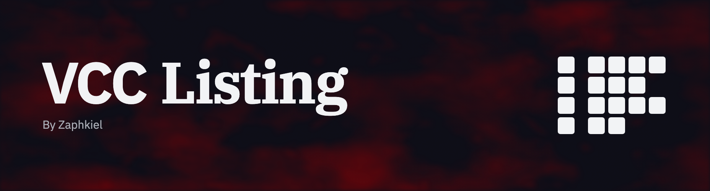

<p align="center">
  
</p>

A self-hosted package listing for the [VRChat Creator Companion](https://vcc.docs.vrchat.com/) (VCC). It reads the GitHub releases of the repositories you list, builds the VPM `index.json` from them, and serves it next to a page where users choose which packages they want.

## How it works

- A background task polls the GitHub API every five minutes with conditional requests. An unchanged repository answers `304` and costs nothing against the rate limit.
- The listing is rebuilt in memory when a repository changes, then compressed once with Brotli and gzip. Requests never reach GitHub.
- Package archives are not proxied. Each version points to its GitHub release asset.
- Unchecking packages on the page produces a URL such as `/index.json?p=com.a,com.b`. That listing has its own `id`, so VCC keeps it apart from the full one.

The server and the page ship as one static binary in a `scratch` image of about 5 MB.

## Quick start

```sh
git clone https://github.com/Zaphkiel-Ivanovna/zaphkiel-vcc.git
cd zaphkiel-vcc
cp .env.example .env
docker compose up -d --build
```

Set `REPOS` in `.env` before starting. The container listens on port 8080 and expects a reverse proxy in front of it for TLS.

Production runs from `deploy/compose.yaml` through Portainer GitOps. After each image build on `main`, CI pins the new `sha-*` tag in that file, and Portainer redeploys when it sees the commit.

## Configuration

| Variable            | Default                    | Description                                                                           |
| ------------------- | -------------------------- | ------------------------------------------------------------------------------------- |
| `REPOS`             | required                   | Comma-separated GitHub repositories, as full links or `owner/repo`                    |
| `GITHUB_TOKEN`      | none                       | Raises the GitHub API limit from 60 to 5,000 requests per hour                        |
| `LISTING_NAME`      | `Zaphkiel VCC`             | Name shown in VCC                                                                     |
| `LISTING_AUTHOR`    | `Zaphkiel`                 | Author shown in VCC                                                                   |
| `LISTING_ID`        | `dev.zaphkiel.vcc`         | Identifier VCC uses to tell listings apart                                            |
| `PUBLIC_URL`        | `https://vcc.zaphkiel.dev` | Public address of the server, written to the listing's `url` field                    |
| `REFRESH_SECONDS`   | `300`                      | Delay between two GitHub polls                                                        |
| `PORT`              | `8080`                     | Listening port                                                                        |
| `RYBBIT_SCRIPT_URL` | none                       | Address of a [Rybbit](https://rybbit.io) tracking script, see [Analytics](#analytics) |

## Publishing a package

A release appears in the listing when its assets include:

- `package.json`, the package manifest, with a `name` and a valid semver `version`
- a `.zip` of the package, ideally named `<name>-<version>.zip`

Draft releases are skipped. Pre-releases are listed, and VCC hides them unless the user asks for them.

[`examples/release.yml`](examples/release.yml) is a GitHub Actions workflow that publishes releases in this format. Copy it to `.github/workflows/` in a package repository whose `package.json` sits at the root.

## Endpoints

| Path                        | Response                              |
| --------------------------- | ------------------------------------- |
| `/index.json`               | Listing with every package            |
| `/index.json?p=com.a,com.b` | Listing limited to the given packages |
| `/`                         | Package selection page                |
| `/packages/<id>/`           | Page of one package, with its README  |
| `/sitemap.xml`              | Sitemap of every page                 |

Listing responses carry an `ETag` and `Cache-Control: public, max-age=60`, so a CDN can sit in front of the server.

## Languages and SEO

The page is published in English (`/`) and French (`/fr/`). To add a language, create a file in `apps/web/src/i18n/` modelled on `fr.ts`, then register it in `locales.ts`, `index.ts` and the `locales` list of `astro.config.mjs`.

Every package gets its own page at `/packages/<id>/` (and `/fr/packages/<id>/`), built by the server from the README of its repository. The first image of the README that is not a badge becomes the page's social preview.

Each page ships a canonical URL, `hreflang` alternates, Open Graph and Twitter tags. The server generates `sitemap.xml` and `robots.txt` from the current packages. The server writes the package list and its schema.org description into the HTML, so crawlers that do not run JavaScript still read the packages. Listing responses carry `X-Robots-Tag: noindex`.

Canonical, sitemap and social URLs use `PUBLIC_URL`.

## Analytics

Analytics are off by default. Set `RYBBIT_SCRIPT_URL` to the script address of a Rybbit site, for example `https://rybbit.example.com/api/script.js?siteId=abc123`, and the server adds the script to every page. The address must start with `https://`.

Rybbit records page views, referrers and outbound links on its own. The page adds two events:

| Event           | Sent when                                              | Properties                                                               |
| --------------- | ------------------------------------------------------ | ------------------------------------------------------------------------ |
| `listing_added` | A visitor clicks "Add to VCC" or copies the URL        | `scope`, `method`, `source`, `locale`, `package_count`, `total_packages` |
| `package_added` | Once per package, when the listing is not the full one | `package`, `method`, `source`, `locale`                                  |

- `scope` is `all` for the full listing, `selection` for a subset chosen on the home page, `single` for the one-package button of a package page.
- `method` is `vcc_link` or `copy_url`.
- `source` is `home` or `package_page`. The counts are only sent from the home page.

The split of `listing_added` by `scope` tells how many visitors take everything. `package_added` grouped by `package` ranks the packages people pick on purpose.

These events count clicks on the page. VCC fetches `/index.json` without running any script, so its requests, and users who paste the URL by hand, do not appear in Rybbit.

## Development

Requirements: Rust 1.88 or later and [Bun](https://bun.sh) 1.4.

```sh
bun install
bun run build
REPOS=owner/repo cargo run
```

The API embeds `apps/web/dist` at compile time, so build the page before running `cargo run`. To work on the page with hot reload, keep the API running and start `bun run dev`. The dev server forwards `/index.json` to port 8080.

| Command                      | Purpose                                |
| ---------------------------- | -------------------------------------- |
| `bun run check`              | Type-check the Astro project           |
| `bun run lint`               | Run oxlint with type-aware rules       |
| `bun run format`             | Format with oxfmt                      |
| `cargo fmt --all`            | Format the Rust code                   |
| `cargo clippy --all-targets` | Run clippy with the workspace lint set |

## Project layout

```
apps/
  api/        Rust server (axum): GitHub polling, listing, HTTP routes
  web/        Astro page embedded in the server binary
examples/     Release workflow for package repositories
```

The repository root holds the Cargo workspace and the Bun workspace.
